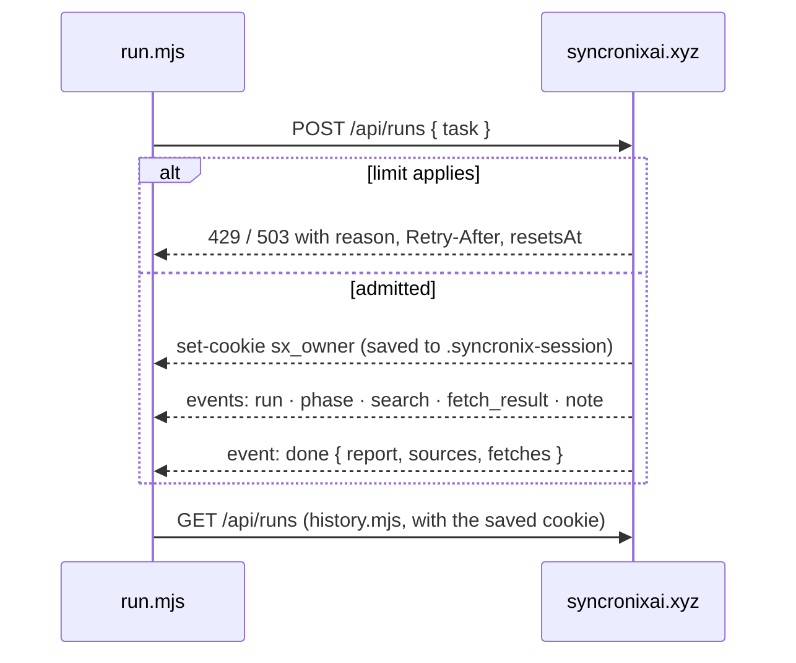

<p align="center">
  
</p>

<h1 align="center">SYNCRONIX Examples</h1>

<p align="center">
  Working code for SYNCRONIX: call the research API, look up wallets, or build the grounded research pattern yourself.<br>
  <a href="https://syncronixai.xyz">Website</a> · <a href="https://github.com/SyncronixLabs/syncronix-docs/blob/main/api.md">API reference</a> · <a href="https://github.com/SyncronixLabs/syncronix-docs">Docs</a> · <a href="https://github.com/SyncronixLabs/syncronix-docs/blob/main/whitepaper.md">Whitepaper</a> · <a href="CHANGELOG.md">Changelog</a>
</p>

---

## Examples

| | Example | What it shows | Needs | Cost |
|---|---|---|---|---|
| 🔌 | [**public-api**](public-api/) | Start a run on syncronixai.xyz, stream its progress, check your quota, read your private history; plus curl | Node.js 18+, no dependencies | Free (1 run per day) |
| 🔎 | [**wallet**](wallet/) | Wallet Intelligence: activity, first funder, 5-hop funding trace, shared funder, compare, verified vs. inferred graph edges, AI cost estimate | Node.js 18+, no dependencies | Free, no AI call |
| 🧠 | [**grounded-agent**](grounded-agent/) | The core research pattern in one file: Claude + web search + web fetch with citations, a read gate and a grounding check | Node.js 18+, an Anthropic API key | Billed to your Anthropic account |

## Quick start

<details open>
<summary><b>Public API</b> — no key, no dependencies</summary>

```bash
cd public-api
node quota.mjs
node run.mjs "What is the current Node.js Active LTS line and when does it reach end of life?"
node history.mjs
```

```
run 3f2c…
· intent
· plan
  search: Node.js release schedule Active LTS end of life
  read: https://nodejs.org/en/about/previous-releases
  read: https://endoflife.date/nodejs
  Source check: 4/4 links traced to research results
  Grounding: 2 pages read in full · 5/5 findings cite a page that was read
✓ 1 searches · 2 pages read · 12s

## Summary
…
```

*Illustrative output; your run's sources and wording will differ.*

</details>

<details>
<summary><b>Wallet Intelligence</b> — no key, no AI</summary>

```bash
cd wallet
node wallet.mjs 0x…              # a Robinhood Chain mainnet address
node wallet.mjs 0x… --testnet
```

Prints activity, the funding path with an evidence label on every hop (`verified by rpc`, `proven first inflow`
or `earliest found`), any shared funder marked **INFERRED**, and the AI cost estimate. It never starts a paid
analysis. See [wallet/README.md](wallet/README.md) for a full real run.

</details>

<details>
<summary><b>Grounded agent</b> — your own key</summary>

```bash
cd grounded-agent
npm install
export ANTHROPIC_API_KEY=...          # PowerShell: $env:ANTHROPIC_API_KEY="..."
node agent.mjs "How does Solana's Proof of History work, and is it being replaced?"
```

Ends with a line such as `2 searches · 2 pages read · 6/8 findings cite a page that was read`.

</details>

## How the public API client works



## Troubleshooting

<details>
<summary><code>Not started (429 ip_quota)</code></summary>

You've used today's free run. It resets at 00:00 UTC; `node quota.mjs` shows the time in your timezone.

</details>

<details>
<summary><code>Not started (503 busy)</code></summary>

SYNCRONIX runs one research task at a time across all visitors. Try again in a minute.

</details>

<details>
<summary><code>Not started (429 daily_budget)</code></summary>

The shared daily budget is used up. Runs resume at 00:00 UTC.

</details>

<details>
<summary><code>history.mjs</code> shows nothing</summary>

History is private to the session that created it. `run.mjs` saves that session in `public-api/.syncronix-session`;
deleting the file starts a new, empty session.

</details>

<details>
<summary><code>429 rate_limited</code> or <code>503 busy</code> from <code>wallet.mjs</code></summary>

Wallet lookups allow 30 requests and 6 funding traces per minute per visitor, and 3 traces at once across the
service. Wait for the `Retry-After` seconds shown and run it again.

</details>

<details>
<summary><code>Request failed: 401</code> in the grounded agent</summary>

`ANTHROPIC_API_KEY` is missing or invalid in the shell that runs `agent.mjs`.

</details>

History: [CHANGELOG.md](CHANGELOG.md) · Security: [SECURITY.md](SECURITY.md)

<sub>Licensed under the [MIT License](LICENSE).</sub>
